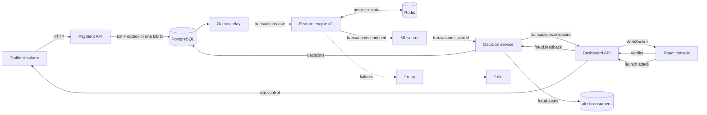

# FraudShield: Real-Time UPI Fraud Detection on Apache Kafka

FraudShield is an event-driven fraud detection platform that scores every payment in **milliseconds** using streaming features, business rules and machine learning, and puts flagged payments in front of analysts on a live dashboard. Analyst verdicts flow back through Kafka to retrain the model.

It is built the way payment companies build these systems: a transactional outbox, exactly-once stream processing, Avro contracts in Schema Registry, retry and dead-letter topics, horizontally scaled consumer groups, and full observability.

   

---

## Why

India processes over 15 billion UPI payments a month. Fraud such as account takeover, card testing, mule transfers and social-engineering scams happens in seconds, so a nightly batch job finds it **after the money is gone**. Fraud has to be decided *while the payment is in flight*, with a reason an analyst or regulator can understand.

## What it does

* Accepts payments through a REST API and records them **atomically** with an outbox event.
* Streams each payment through **feature engineering → rules + ML scoring → decision** with Kafka transactions.
* Decides **APPROVE / REVIEW / BLOCK** in about 150 ms end to end (p95 under 200 ms on a laptop).
* Explains every alert with **SHAP feature contributions** and the rules it triggered.
* Gives analysts a **live console**: stream, alert queue, case review, analytics and cluster health.
* Captures analyst verdicts on a compacted `fraud.feedback` topic for **retraining**.

## Architecture



### Topics

| Topic | Partitions | Key | Purpose |
|---|---|---|---|
| `transactions.raw` | 6 | `user_id` | Accepted payments from the outbox |
| `transactions.enriched` | 6 | `user_id` | Payment + 21 streaming features |
| `transactions.scored` | 6 | `user_id` | Rule hits, ML score, anomaly score, SHAP reasons |
| `transactions.decisions` | 6 | `user_id` | Every final decision (live feed) |
| `fraud.alerts` | 3 | `user_id` | REVIEW and BLOCK decisions only |
| `fraud.feedback` | 3 (compacted) | `txn_id` | Latest analyst verdict per transaction |
| `sim.control` | 1 | | Attack commands from the console |
| `<topic>.retry` / `<topic>.dlq` | 3 / 1 | original | Backoff retries and poison messages |

Keying by `user_id` guarantees that all events for one user land on one partition, are processed **in order**, and by **one consumer instance**, which keeps per-user feature state race-free.

## Tech stack

| Layer | Technology |
|---|---|
| Streaming | Apache Kafka 3.7 (Confluent Platform 7.7, KRaft, no ZooKeeper) |
| Contracts | Confluent Schema Registry + Avro |
| Services | Python 3.12, confluent-kafka, FastAPI, Uvicorn |
| Storage | PostgreSQL 16 (transactions, outbox, decisions), Redis 7 (feature state) |
| ML | XGBoost, scikit-learn Isolation Forest, TreeSHAP |
| Frontend | React 18, Vite, Recharts, served by Nginx |
| Observability | Prometheus, Grafana, kafka-exporter, Kafka UI |
| Runtime | Docker Compose |

## Reliability design

| Concern | How it is handled |
|---|---|
| Dual write (DB + Kafka) | **Transactional outbox**: payment and event committed in one Postgres transaction, relay publishes with `FOR UPDATE SKIP LOCKED` |
| Duplicate API calls | `Idempotency-Key` header with a unique constraint |
| Producer retries | `enable.idempotence=true`, `acks=all` |
| Consume → process → produce | **Kafka transactions** (`send_offsets_to_transaction`), `isolation.level=read_committed` |
| Side effects outside Kafka | Redis feature cache keyed by `txn_id`, Postgres `ON CONFLICT DO NOTHING` |
| Transient failures | Retry topic with exponential backoff headers (`x-attempt`, `x-not-before`) |
| Poison messages | Dead-letter topic with error, source partition and offset headers |
| Instance crashes | Consumer groups with cooperative-sticky rebalancing; crashed containers restart and resume from committed offsets |
| Schema drift | Avro schemas registered in Schema Registry |

## Machine learning

* **21 streaming features** computed per user from Redis state: velocity (1m / 10m / 1h), spend vs. user baseline, distance and implied travel speed, new device, new payee, time of day, account age.
* **The same feature code** (`common/features.py`) is used for offline training and online serving, so there is no training/serving skew.
* **XGBoost** (supervised, `scale_pos_weight` for 2% fraud) + **Isolation Forest** (unsupervised, catches novel patterns) + **deterministic rules** (hard policy).
* `risk = max(rule_score, 0.85 × xgboost + 0.15 × anomaly)`, with REVIEW at ≥ 0.5 and BLOCK at ≥ 0.8.
* **TreeSHAP** via XGBoost `pred_contribs` gives the top reasons per decision in about 1 ms.
* Temporal 80/20 split on 200k synthetic transactions (2,000 users, 7 days):

| Approach | PR-AUC | Precision | Recall |
|---|---|---|---|
| Rules only | 0.285 | 99.5% | 27.6% |
| Isolation Forest only | 0.749 | 37.5% | 90.8% |
| XGBoost only | 0.988 | 78.5% | 98.2% |
| **Combined** | **0.986** | **80.3%** | **98.0%** |

These numbers come from simulated data with known fraud patterns. Real-world fraud data is noisier, and a PR-AUC of 0.3 to 0.7 is typical there.

## Quick start

Requirements: Docker (Docker Desktop or Docker Engine) with about 6 GB of RAM allocated.

Create a `.env` file with your own local passwords. It is git-ignored and never committed:

```bash
for key in POSTGRES_PASSWORD GF_SECURITY_ADMIN_PASSWORD; do echo "$key"="$(openssl rand -hex 16)"; done > .env
docker compose up --build -d
```

The first start trains the model, which takes about 2 minutes. Then open:

| URL | What |
|---|---|
| http://localhost:3000 | FraudShield analyst console |
| http://localhost:3001 | Grafana pipeline dashboard |
| http://localhost:8080 | Kafka UI (topics, messages, schemas, groups) |
| http://localhost:8000/docs | Payment API (OpenAPI) |
| http://localhost:8001/docs | Dashboard API (OpenAPI) |
| http://localhost:9090 | Prometheus |

### Demo script

1. Open the console. The live feed streams about 20 payments per second.
2. Pick **Card Testing × 3** and click **Launch attack**. Red BLOCK rows appear within seconds.
3. Click a blocked row to open the case: score breakdown, SHAP reasons, rule hits, user history.
4. Click **Confirm fraud**. The verdict is published to `fraud.feedback` and applied by the decision service.
5. Scale and break things:

```bash
docker compose up -d --scale feature-engine=3
docker compose stop ml-scorer
docker compose start ml-scorer
```

While `ml-scorer` is stopped, lag on `transactions.enriched` grows in **System health** and Grafana. When it restarts, it drains the backlog with no lost or duplicated decisions.

### Retrain with analyst feedback

```bash
docker compose run --rm trainer python -m ml.train --out /models --with-feedback
docker compose restart ml-scorer
```

## Configuration

`POSTGRES_PASSWORD` and `GF_SECURITY_ADMIN_PASSWORD` are required and exist only in `.env`. Containers load that file with `env_file`, so no credentials appear anywhere in the repository. Everything else has a working default. Set values in the git-ignored `.env` file next to `docker-compose.yml`.

| Variable | Default | Meaning |
|---|---|---|
| `POSTGRES_PASSWORD` | required | Database password |
| `POSTGRES_USER` / `POSTGRES_DB` | fraud / fraudshield | Database user and name |
| `REVIEW_THRESHOLD` / `BLOCK_THRESHOLD` | 0.5 / 0.8 | Decision policy |
| `SIM_TPS` | 20 | Simulated payments per second |
| `SIM_USERS` | 100000 | Simulated customers |
| `SIM_FRAUD_RATE` | 0.02 | Background fraud rate |
| `MAX_RETRIES` / `RETRY_BACKOFF_SECONDS` | 3 / 1.0 | Retry policy before DLQ |
| `FEATURE_ENGINE_REPLICAS` | 2 | Feature engine instances |
| `GF_SECURITY_ADMIN_PASSWORD` | required | Grafana admin password |
| `GRAFANA_ADMIN_USER` | admin | Grafana admin user |
| `LOG_LEVEL` | INFO | Service log level |

No external API keys or cloud accounts are required.

## Project layout

```
common/             shared library: config, schemas, Kafka runtime, features, rules, model, simulation
services/
  payment_api/      FastAPI intake + transactional outbox
  outbox_relay/     Postgres outbox -> transactions.raw
  feature_engine/   stateful streaming features (Redis)
  ml_scorer/        rules + XGBoost + Isolation Forest + SHAP
  decision_service/ decision policy, persistence, alerts, analyst feedback
  dashboard_api/    REST + WebSocket + Kafka lag monitor
  simulator/        realistic UPI traffic and fraud attacks
ml/train.py         offline training and evaluation
frontend/           React analyst console
monitoring/         Prometheus + Grafana provisioning
db/init.sql         database schema
tests/              unit tests (no Docker needed)
```

## Running tests

```bash
python -m venv .venv && . .venv/bin/activate
pip install -r requirements-dev.txt
pytest -q
python -m ml.train --out ml/artifacts --events 50000
```

## Roadmap

* Multi-broker cluster with `replication.factor=3` and `min.insync.replicas=2`
* Debezium CDC instead of a polling outbox relay
* Flink or Kafka Streams for windowed aggregations at higher scale
* Online model registry with shadow scoring and canary rollout
* Graph features to detect mule account networks
